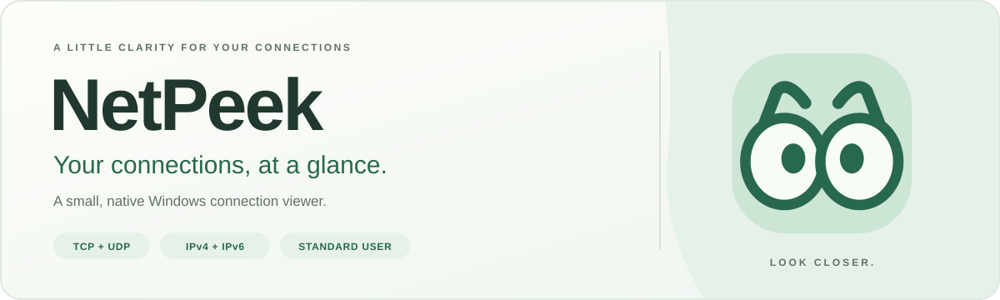
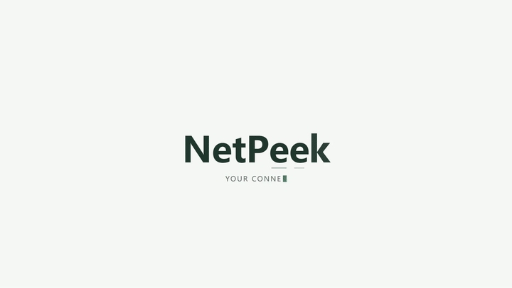
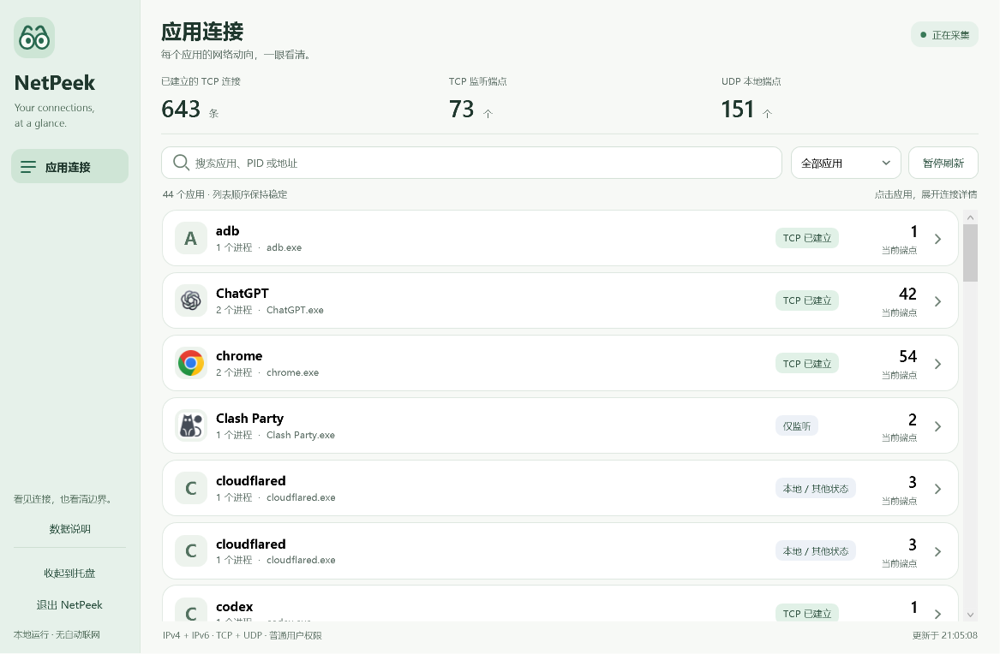
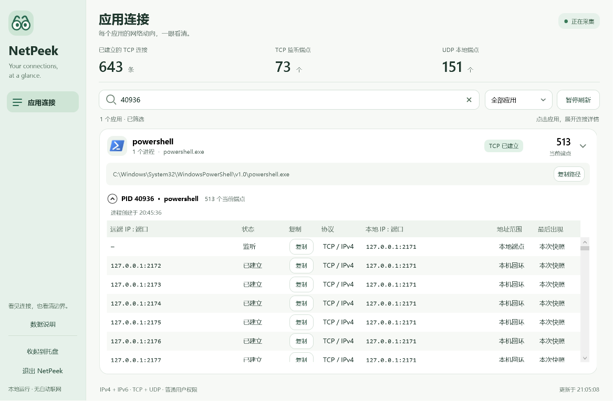

<p align="center">
  <a href="https://github.com/seiya058904/netpeek/releases/latest">
    
  </a>
</p>

<h1 align="center">NetPeek</h1>

<p align="center"><strong>Your connections, at a glance.</strong></p>
<p align="center">
  A small, native Windows utility for the apps, processes and endpoints behind your connections.<br />
  Expand an app. Inspect its connections. Copy the detail you need.
</p>

<p align="center">
  <a href="https://github.com/seiya058904/netpeek/releases/tag/v0.1.1"></a>
  
  
  <a href="LICENSE"></a>
</p>

<p align="center">
  <a href="https://github.com/seiya058904/netpeek/releases/latest"><strong>Download for Windows →</strong></a>
  &nbsp;·&nbsp; <a href="#preview">Preview</a>
  &nbsp;·&nbsp; <a href="#get-started">Quick start</a>
  &nbsp;·&nbsp; <a href="#what-the-data-means">Reading the data</a>
  &nbsp;·&nbsp; <a href="#development">Development</a>
</p>

<p align="center"><sub>Standard user privileges · No capture driver · No telemetry · Simplified Chinese interface</sub></p>

<a id="preview"></a>

## 🖼️ A peek inside

<p align="center"></p>


<p align="center">
  
</p>
<p align="center">
  <sub>Final v0.1.1 EXE · Live local sampling · Offscreen rendering of real WPF controls.<br />
  These previews are not physical-desktop or high-DPI acceptance screenshots.</sub>
</p>

<details>
<summary><strong>Open the connection detail view</strong></summary>



This view uses controlled loopback connections. Full IPv6 addresses can be inspected and copied; paths support text selection and horizontal scrolling. See the [layout and acceptance evidence](docs/VALIDATION_0.1.1.md#交互布局与截图) for the capture conditions.

</details>

<a name="看连接也看清边界"></a>

## 🔎 From an app to an endpoint

<table>
  <tr>
    <td width="50%" valign="top">
      <a name="从应用开始"></a>
      <h3>Start with the app</h3>
      <p>Group by verified executable path, then expand the process, PID and full path. Apps with the same name but different paths stay separate.</p>
    </td>
    <td width="50%" valign="top">
      <a name="连接细节一步展开"></a>
      <h3>Follow the connection</h3>
      <p>Inspect TCP / UDP, IPv4 / IPv6, addresses, ports and states. Addresses, state and copy actions take priority in the detail view.</p>
    </td>
  </tr>
  <tr>
    <td width="50%" valign="top">
      <a name="安静地留在手边"></a>
      <h3>Keep it close</h3>
      <p>Search, filter, pause and restore from the tray. Incremental refresh preserves existing row objects; recent history stays in memory.</p>
    </td>
    <td width="50%" valign="top">
      <a name="只展示可靠的事实"></a>
      <h3>Know what is certain</h3>
      <p>If sampling fails, keep the last complete view with its timestamp. Unverified identities stay marked as uncertain; traffic, website ownership and risk are not guessed.</p>
    </td>
  </tr>
</table>

<a id="get-started"></a>
<a name="三步开始"></a>

## 📦 Get started

1. **Download** the Windows x64 portable ZIP from [GitHub Releases](https://github.com/seiya058904/netpeek/releases/latest).
2. **Extract the whole folder** and open **NetPeek.exe**. No installer or administrator privileges are needed.
3. **Explore an app**, expand its processes and endpoints, then search by name, PID, IP, port or protocol and copy the address you need.

### Choose your download · v0.1.1

| Asset | What is inside |
| --- | --- |
| **[Windows x64 portable ZIP](https://github.com/seiya058904/netpeek/releases/download/v0.1.1/NetPeek_0.1.1_windows_x64.zip)** · 1.22 MiB | The app, corresponding source code and licenses |
| [Source ZIP](https://github.com/seiya058904/netpeek/releases/download/v0.1.1/NetPeek_0.1.1_source.zip) | Corresponding source, build scripts, tests and documentation |
| [SHA256SUMS.txt](https://github.com/seiya058904/netpeek/releases/download/v0.1.1/SHA256SUMS.txt) | Checksums for the release downloads |

| Before you open it | Requirement or status |
| --- | --- |
| **System** | Windows 10/11 x64; actual machine validation used Windows 11. Windows 10 coverage across machines is incomplete. |
| **Runtime** | .NET Framework 4.8 or a later Framework version must already be installed. It is not bundled or downloaded automatically. |
| **Interface** | Simplified Chinese |
| **Package** | Portable; the executable is not code-signed |

<details>
<summary><strong>Everyday controls and keyboard shortcuts</strong></summary>

- **Search and filter:** Find a name, path, PID, IP, port or protocol. An empty result offers a one-click reset to all apps.
- **Copy:** Connections copy the remote address; listeners and UDP rows copy the local endpoint. IPv6 uses `[address%scope]:port`, and Copy path preserves the full executable path.
- **Pause:** Freeze the display while sampling continues in the background. Resume to show the latest complete snapshot.
- **Tray:** The tray action hides the window. Double-click the tray icon or launch NetPeek again to restore it. Each Windows user session has one UI instance.
- **Exit:** Closing the window, Alt+F4 and Exit NetPeek all quit the application completely.

| Shortcut | Action |
| --- | --- |
| `Ctrl+F` / `Ctrl+P` | Search / pause or resume the display |
| `F5` / `Esc` | Request a sample / clear search and collapse help |
| `Tab` / `Shift+Tab` | Move through controls |
| `Space` / `Enter` | Expand or collapse the focused entry |
| `Ctrl+C` | Copy the selected endpoint; text fields keep normal copy behavior |

</details>

<a id="what-the-data-means"></a>
<a name="这些数据意味着什么"></a>

## 🧭 What the data can tell you

**An established TCP connection does not prove data is moving.** A listener is waiting for connections. The Windows UDP tables expose local bindings only, so remote endpoints are explicitly unknown. NetPeek is a connection viewer; it does not measure bandwidth, filter traffic or identify websites.

| What you can observe | What to keep in mind |
| --- | --- |
| Endpoints, PIDs and states in the Windows connection tables | The four tables and process information are not one atomic snapshot; short-lived connections can be missed. |
| Process start times verified before and after reading the tables | Rows with unverified process identity preserve UI interaction only, not trusted history. |
| Current endpoints and observations from the previous 60 seconds | History is capped at 12,000 entries. Last observed is not the exact time a connection closed. |
| The scope of the visible address | Proxies, VPNs and Fake-IP may expose only a proxy, tunnel or mapped endpoint. NetPeek cannot reconstruct the real website behind it. |

After each sampling round completes, NetPeek waits **1.5 seconds** before the next round. Current endpoints are marked as belonging to the current snapshot; the footer shows the exact sampling time. History rows show when they were last observed. A view that has not updated for more than **6 seconds** is marked stale.

<a name="本地运行普通权限"></a>

## 🔒 Local by design

One native WPF process reads the Windows connection tables directly. Ordinary use needs no Npcap, browser wrapper, background HTTP server or account. There is no telemetry or automatic updating; NetPeek does not initiate network requests or load application icons from network locations.

Normal use writes no connection logs. An unhandled exception overwrites `%LOCALAPPDATA%\NetPeek\last-error.txt`. Explicit diagnostic reports can contain local paths and endpoints, so review them before sharing.

<a id="development"></a>
<a name="开发与验证"></a>

## 🛠️ Build and verify

**C# / WPF · .NET Framework 4.8 · Windows IP Helper API**

Build from the repository root using the system-installed .NET Framework `csc.exe`. No additional SDK, NuGet, npm or Python is required. Use Windows PowerShell 5.1 or PowerShell 7:

```powershell
.\build.ps1
.\tests\run-core-tests.ps1
.\tests\run-viewmodel-tests.ps1 -Executable .\dist\NetPeek\NetPeek.exe
```

<details>
<summary><strong>Full checks, diagnostics and packaging commands</strong></summary>

```powershell
.\tests\run-core-tests.ps1 -Executable .\dist\NetPeek\NetPeek.exe
.\tests\run-icon-cache-tests.ps1 -Executable .\dist\NetPeek\NetPeek.exe
.\tests\run-layout-tests.ps1 -Executable .\dist\NetPeek\NetPeek.exe
.\tests\run-controller-state-tests.ps1 -Executable .\dist\NetPeek\NetPeek.exe
.\tests\IntegrationTests.ps1
.\build.ps1 -Package -SkipBuild
```

`-SkipBuild` reuses the tested EXE; `-Executable` loads the application code from the specified EXE. Build output goes to the Git-ignored `dist/` directory. Official distribution packages live in GitHub Releases.

Explicit socket checks may trigger a Windows Firewall prompt. Normal NetPeek use does not require an inbound firewall exception:

```powershell
.\tests\IntegrationTests.ps1 -LiveSockets -StressConnections 256 -ExternalHost github.com
.\scripts\Measure-NetPeek.ps1
```

Diagnostic commands write reports only when an output path is explicitly supplied:

```powershell
.\dist\NetPeek\NetPeek.exe --snapshot C:\Temp\netpeek_snapshot.json
.\dist\NetPeek\NetPeek.exe --smoke-test C:\Temp\netpeek_smoke.json
```

A complete snapshot may contain zero endpoints. Smoke acceptance checks the current run's identity, time, valid snapshot and final state; a report file's existence alone does not mean success. Explicit fault-injection checks cover a UI exception after report creation, persistent sampling failure and a complete zero-endpoint snapshot.

If local execution policy blocks a script, `powershell.exe -NoProfile -ExecutionPolicy Bypass -File .\build.ps1` applies to that PowerShell process only.

</details>

### Recorded validation · v0.1.1

**The final v0.1.1 EXE passed 125 targeted checks and 70 integration checks.** Full interaction, high-DPI and three-scenario performance records come from a candidate built before the final column-width patch; the final build's additional retesting is incomplete. Windows 10, multiple monitors, adapter changes and sleep/resume also remain unverified. These records do not establish a blanket compatibility or performance guarantee.

| Record | What you will find |
| --- | --- |
| [Changelog](docs/CHANGELOG.md) | Changes between versions |
| [v0.1.1 validation and performance](docs/VALIDATION_0.1.1.md) | Measured results, capture conditions and unfinished acceptance work |
| [v0.1.0 archive](docs/VALIDATION.md) | Earlier validation evidence |
| [Upstream audit](docs/UPSTREAM_AUDIT.md) | Review of the original project's behavior and implementation |

The detailed engineering and acceptance records are currently in Simplified Chinese.

<a name="致谢与许可证"></a>

## 🌱 Credits and license

NetPeek grew from the product ideas and source audit of [aiXis Studio / Snitch](https://github.com/aixisstudio/Snitch). Its Windows collector and desktop interface were independently rewritten. It uses its own name, assembly, session identifiers and data directory, and does not connect to Snitch's update channel.

Licensed under **[AGPL-3.0-or-later](LICENSE)**, with upstream and PCYBOX Orbis attribution preserved in the [third-party notices](THIRD_PARTY_NOTICES.md). The portable package includes the complete corresponding source. Keep the source and licenses with any redistribution.

---

<p align="center">
  <br />
  <em>A little clarity for your connections.</em><br />
  <a href="https://github.com/seiya058904/netpeek/releases/latest"><strong>Take a peek →</strong></a>
  &nbsp;·&nbsp; <a href="#netpeek">Back to top ↑</a>
</p>
