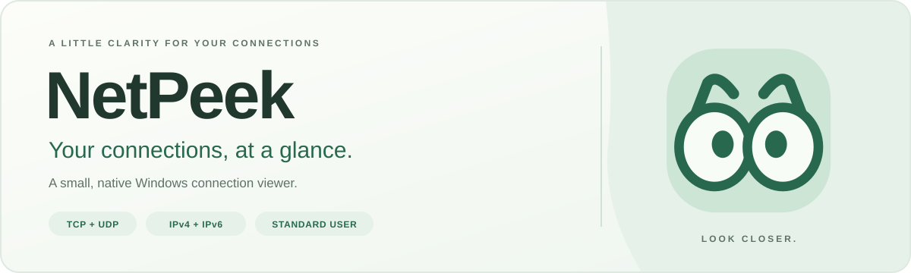
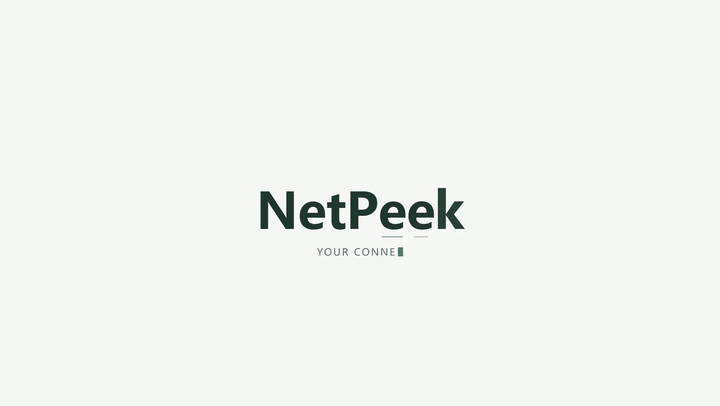
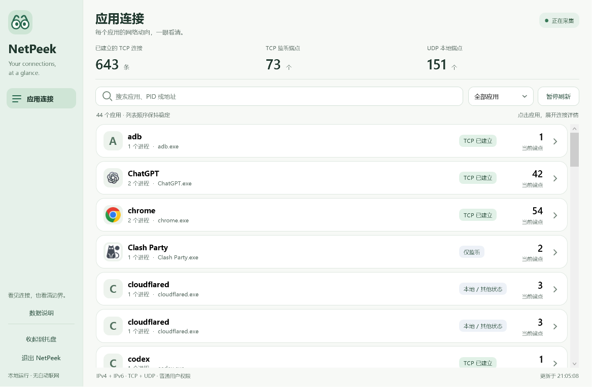
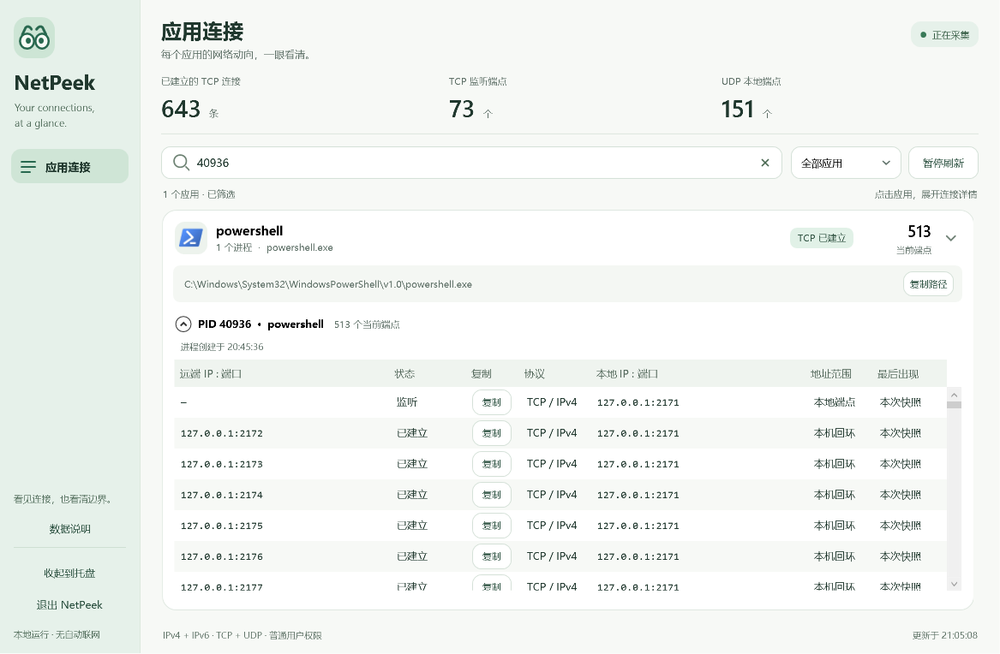

<p align="center">
  <a href="https://github.com/seiya058904/netpeek/releases/latest">
    
  </a>
</p>

<h1 align="center">NetPeek</h1>

<p align="center"><strong>Your connections, at a glance.</strong></p>
<p align="center">
  A small, native Windows utility for the apps, processes and endpoints behind your connections.<br />
  Expand an app. Inspect its connections. Copy the detail you need.
</p>

<p align="center">
  <a href="https://github.com/seiya058904/netpeek/releases/tag/v0.2.0"></a>
  
  
  <a href="LICENSE"></a>
</p>

<p align="center">
  <a href="https://github.com/seiya058904/netpeek/releases/latest"><strong>Download for Windows →</strong></a>
  &nbsp;·&nbsp; <a href="#preview">Preview</a>
  &nbsp;·&nbsp; <a href="#get-started">Quick start</a>
  &nbsp;·&nbsp; <a href="#what-the-data-means">Reading the data</a>
  &nbsp;·&nbsp; <a href="#development">Development</a>
</p>

<p align="center"><sub>Standard user privileges · No capture driver · No telemetry · Simplified Chinese interface</sub></p>

<a id="preview"></a>

## 🖼️ A peek inside

<p align="center"></p>


<p align="center">
  
</p>
<p align="center">
  <sub>Illustrative v0.1.1 previews; v0.2.0 adds the endpoint workflows described below.<br />
  Live local sampling · Offscreen rendering of real WPF controls.<br />
  These previews are not physical-desktop or high-DPI acceptance screenshots.</sub>
</p>

<details>
<summary><strong>Open the connection detail view</strong></summary>



This view uses controlled loopback connections. Full IPv6 addresses can be inspected and copied; paths support text selection and horizontal scrolling. See the [layout and acceptance evidence](docs/VALIDATION_0.1.1.md#交互布局与截图) for the capture conditions.

</details>

<a name="看连接也看清边界"></a>

## 🔎 From an app to an endpoint

<table>
  <tr>
    <td width="50%" valign="top">
      <a name="从应用开始"></a>
      <h3>Start with the app</h3>
      <p>Group by verified executable path, then expand the process, PID and full path. Apps with the same name but different paths stay separate.</p>
    </td>
    <td width="50%" valign="top">
      <a name="连接细节一步展开"></a>
      <h3>Follow the connection</h3>
      <p>Inspect TCP / UDP, IPv4 / IPv6, addresses, ports and states. Addresses, state and copy actions take priority in the detail view.</p>
    </td>
  </tr>
  <tr>
    <td width="50%" valign="top">
      <a name="安静地留在手边"></a>
      <h3>Keep it close</h3>
      <p>Search, filter, pause and restore from the tray. Incremental refresh preserves existing row objects; recent history stays in memory.</p>
    </td>
    <td width="50%" valign="top">
      <a name="只展示可靠的事实"></a>
      <h3>Know what is certain</h3>
      <p>If sampling fails, keep the last complete view with its timestamp. Unverified identities stay marked as uncertain; traffic, website ownership and risk are not guessed.</p>
    </td>
  </tr>
</table>

<a id="get-started"></a>
<a name="三步开始"></a>

## 📦 Get started

1. **Download** the Windows x64 portable ZIP from [GitHub Releases](https://github.com/seiya058904/netpeek/releases/latest).
2. **Extract the whole folder** and open **NetPeek.exe**. No installer or administrator privileges are needed.
3. **Explore an app**, expand its processes and endpoints, then search by name, PID, IP, port or protocol and copy the address you need.

### Choose your download · v0.2.0

| Asset | What is inside |
| --- | --- |
| **[Windows x64 portable ZIP](https://github.com/seiya058904/netpeek/releases/download/v0.2.0/NetPeek_0.2.0_windows_x64.zip)** | The app, corresponding source code and licenses |
| [Source ZIP](https://github.com/seiya058904/netpeek/releases/download/v0.2.0/NetPeek_0.2.0_source.zip) | Corresponding source, build scripts, tests and documentation |
| [SHA256SUMS.txt](https://github.com/seiya058904/netpeek/releases/download/v0.2.0/SHA256SUMS.txt) | Checksums for the release downloads |

| Before you open it | Requirement or status |
| --- | --- |
| **System** | Windows 10/11 x64; actual machine validation used Windows 11. Windows 10 coverage across machines is incomplete. |
| **Runtime** | .NET Framework 4.8 or a later Framework version must already be installed. It is not bundled or downloaded automatically. |
| **Interface** | Simplified Chinese |
| **Package** | Portable; the executable is not code-signed |

<details>
<summary><strong>Everyday controls and keyboard shortcuts</strong></summary>

- **Search and filter:** Find a name, path, PID, IP, port or protocol. An empty result offers a one-click reset to all apps.
- **Copy:** Connections copy the remote address; listeners and UDP rows copy the local endpoint. IPv6 uses `[address%scope]:port`, and Copy path preserves the full executable path.
- **Pause:** Freeze the display while sampling continues in the background. Resume to show the latest complete snapshot.
- **Tray:** The tray action hides the window. Double-click the tray icon or launch NetPeek again to restore it. Each Windows user session has one UI instance.
- **Exit:** Closing the window, Alt+F4 and Exit NetPeek all quit the application completely.

| Shortcut | Action |
| --- | --- |
| `Ctrl+F` / `Ctrl+P` | Search / pause or resume the display |
| `F5` / `Esc` | Request a sample / clear search or close the focused detail window |
| `Tab` / `Shift+Tab` | Move through controls |
| `Space` / `Enter` | Expand or collapse the focused entry |
| `Ctrl+C` | Copy the selected endpoint; text fields keep normal copy behavior |
| `Shift+F10` | Open the selected endpoint's copy menu |
| `Enter` in search | Locate the first matching endpoint |

</details>

<a id="what-the-data-means"></a>
<a name="这些数据意味着什么"></a>

## 🧭 What the data can tell you

**An established TCP connection does not prove data is moving.** A listener is waiting for connections. The Windows UDP tables expose local bindings only, so remote endpoints are explicitly unknown. NetPeek is a connection viewer; it does not measure bandwidth, filter traffic or identify websites.

| What you can observe | What to keep in mind |
| --- | --- |
| Endpoints, PIDs and states in the Windows connection tables | The four tables and process information are not one atomic snapshot; short-lived connections can be missed. |
| Process start times verified before and after reading the tables | Rows with unverified process identity preserve UI interaction only, not trusted history. |
| Current endpoints and observations from the previous 60 seconds | History is capped at 12,000 entries. Last observed is not the exact time a connection closed. |
| The scope of the visible address | Proxies, VPNs and Fake-IP may expose only a proxy, tunnel or mapped endpoint. NetPeek cannot reconstruct the real website behind it. |

After each sampling round completes, NetPeek waits **1.5 seconds** before the next round. Current endpoints are marked as belonging to the current snapshot; the footer shows the exact sampling time. History rows show when they were last observed. A view that has not updated for more than **6 seconds** is marked stale.

<a name="本地运行普通权限"></a>

## 🔒 Local by design

One native WPF process reads the Windows connection tables directly. Ordinary use needs no Npcap, browser wrapper, background HTTP server or account. There is no telemetry or automatic updating; NetPeek does not initiate network requests or load application icons from network locations.

Normal use writes no connection logs. An unhandled exception overwrites `%LOCALAPPDATA%\NetPeek\last-error.txt`. Explicit diagnostic reports can contain local paths and endpoints, so review them before sharing.

<a id="development"></a>
<a name="开发与验证"></a>

## 🛠️ Build and verify

**C# / WPF · .NET Framework 4.8 · Windows IP Helper API**

### Endpoint workflow improvements · v0.2.0

Version 0.2.0 adds the following workflows. The preview images above remain clearly labelled v0.1.1 examples.

- **Find the endpoint:** Search filters the process and endpoint details, not just application cards. App names and paths match their application's endpoints; a full PID matches a process; IP, port and protocol searches match individual endpoints. State and time conditions must match the same endpoint. Enter locates the first result; later samples preserve retained rows and user expansion.
- **Choose the observation period:** Select all observations (the default), the current snapshot, or history from the previous 60 seconds. Historical state means the last observed state. Result counts describe matching endpoints; the top counters always describe the whole-machine snapshot. “查看该应用全部端点” resets the state/time filters and searches that application's path or PID to restore its full context.
- **Copy the detail you need:** The arrow beside Copy, a row's right-click menu, or `Shift+F10` offers local endpoint, remote endpoint and complete-record copying. UDP and listeners have no available remote-copy action. Complete records include identity, both endpoints, current/history status and a dated observation time. Menu values are captured when the menu opens. Text fields retain ordinary copy behavior.
- **Keep the list usable:** Narrow windows place state/time filters below search. Help and full warning details open in separate, nonmodal windows; long warnings stay on one line in the main window. Closing a detail window or pressing Escape leaves the main window open.

Pause freezes the data used by search, filters and copying; resuming applies the latest complete snapshot. These changes do not add traffic capture, network requests, persistent connection logs or dependencies.

Build from the repository root using the system-installed .NET Framework `csc.exe`. No additional SDK, NuGet, npm or Python is required. Use Windows PowerShell 5.1 or PowerShell 7:

```powershell
.\build.ps1
.\tests\run-core-tests.ps1
.\tests\run-viewmodel-tests.ps1 -Executable .\dist\NetPeek\NetPeek.exe
```

<details>
<summary><strong>Full checks, diagnostics and packaging commands</strong></summary>

```powershell
.\tests\run-core-tests.ps1 -Executable .\dist\NetPeek\NetPeek.exe
.\tests\run-icon-cache-tests.ps1 -Executable .\dist\NetPeek\NetPeek.exe
.\tests\run-layout-tests.ps1 -Executable .\dist\NetPeek\NetPeek.exe
.\tests\run-controller-state-tests.ps1 -Executable .\dist\NetPeek\NetPeek.exe
.\tests\IntegrationTests.ps1
.\tests\run-filter-performance.ps1 -OutputPath .\artifacts\filter-performance.json
.\build.ps1 -Package -SkipBuild
```

`-SkipBuild` reuses the tested EXE; `-Executable` loads the application code from the specified EXE. Build output goes to the Git-ignored `dist/` directory. Official distribution packages live in GitHub Releases.

Explicit socket checks may trigger a Windows Firewall prompt. Normal NetPeek use does not require an inbound firewall exception:

```powershell
.\tests\IntegrationTests.ps1 -LiveSockets -StressConnections 256 -ExternalHost github.com
.\scripts\Measure-NetPeek.ps1
```

The explicit clipboard workflow opens owned loopback sockets, runs the actual application entry point, invokes its rendered controls and compares the Windows clipboard with expected values. It preserves clipboard formats in memory and restores them before the window closes; a newer external clipboard is left untouched. Avoid copying unrelated content while running this check:

```powershell
.\tests\run-wpf-harness.ps1 -Executable .\dist\NetPeek\NetPeek.exe -Mode clipboard -OutputDirectory .\artifacts\clipboard-check
```

The same harness supports `gui`, `dpi` and `benchmark` modes. GUI and benchmark modes use the PID from the explicit loopback fixture in `tests/Start-EndpointLoad.ps1`; see the [v0.2.0 validation record](docs/VALIDATION_0.2.0.md) for scopes and performance comparisons. The harness embeds the product's DPI manifest. Its timings include test-host overhead and are not standalone process footprints.

Diagnostic commands write reports only when an output path is explicitly supplied:

```powershell
.\dist\NetPeek\NetPeek.exe --snapshot C:\Temp\netpeek_snapshot.json
.\dist\NetPeek\NetPeek.exe --smoke-test C:\Temp\netpeek_smoke.json
```

A complete snapshot may contain zero endpoints. Smoke acceptance checks the current run's identity, time, valid snapshot and final state; a report file's existence alone does not mean success. Explicit fault-injection checks cover a UI exception after report creation, persistent sampling failure and a complete zero-endpoint snapshot.

If local execution policy blocks a script, `powershell.exe -NoProfile -ExecutionPolicy Bypass -File .\build.ps1` applies to that PowerShell process only.

</details>

### Recorded validation · v0.2.0

**The final v0.2.0 EXE passed 181 targeted checks, 65 integration checks, 26 clipboard checks and 33 GUI checks.** Clipboard verification uses real owned loopback endpoints, rendered control routes and Windows clipboard equality. GUI coverage includes selection/scroll retention across live samples, pause/resume, tray activation, history expiry and icon reappearance. One search-focus observation remains explicitly unverified.

The same-machine performance comparison uses the same test host for both releases and three repeated samples per scene; its overhead is included. Actual windows were observed at 96 DPI, with compact geometry and DPI conversion checked separately in simulation. Windows 10, real high-DPI/multiple-monitor transitions, adapter changes, sleep/resume and full external keyboard/screen-reader acceptance remain unverified.

| Record | What you will find |
| --- | --- |
| [Changelog](docs/CHANGELOG.md) | Changes between versions |
| [v0.2.0 validation and performance](docs/VALIDATION_0.2.0.md) | Final EXE checks, clipboard results, performance comparison and limits |
| [v0.1.1 validation and performance](docs/VALIDATION_0.1.1.md) | Historical release evidence and its original limitations |
| [v0.1.0 archive](docs/VALIDATION.md) | Earlier validation evidence |
| [Upstream audit](docs/UPSTREAM_AUDIT.md) | Review of the original project's behavior and implementation |

The detailed engineering and acceptance records are currently in Simplified Chinese.

<a name="致谢与许可证"></a>

## 🌱 Credits and license

NetPeek grew from the product ideas and source audit of [aiXis Studio / Snitch](https://github.com/aixisstudio/Snitch). Its Windows collector and desktop interface were independently rewritten. It uses its own name, assembly, session identifiers and data directory, and does not connect to Snitch's update channel.

Licensed under **[AGPL-3.0-or-later](LICENSE)**, with upstream and PCYBOX Orbis attribution preserved in the [third-party notices](THIRD_PARTY_NOTICES.md). The portable package includes the complete corresponding source. Keep the source and licenses with any redistribution.

---

<p align="center">
  <br />
  <em>A little clarity for your connections.</em><br />
  <a href="https://github.com/seiya058904/netpeek/releases/latest"><strong>Take a peek →</strong></a>
  &nbsp;·&nbsp; <a href="#netpeek">Back to top ↑</a>
</p>
